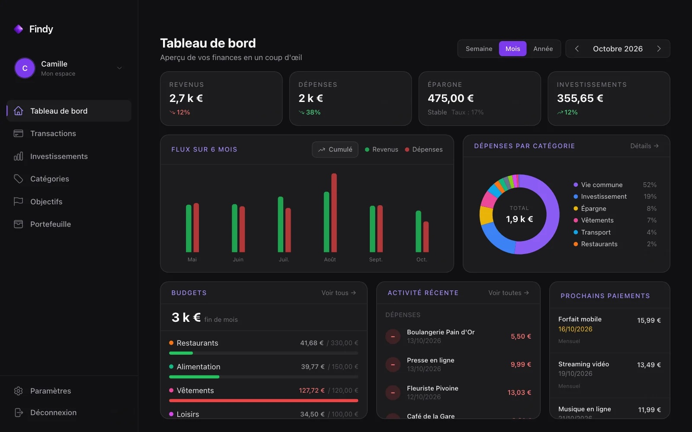
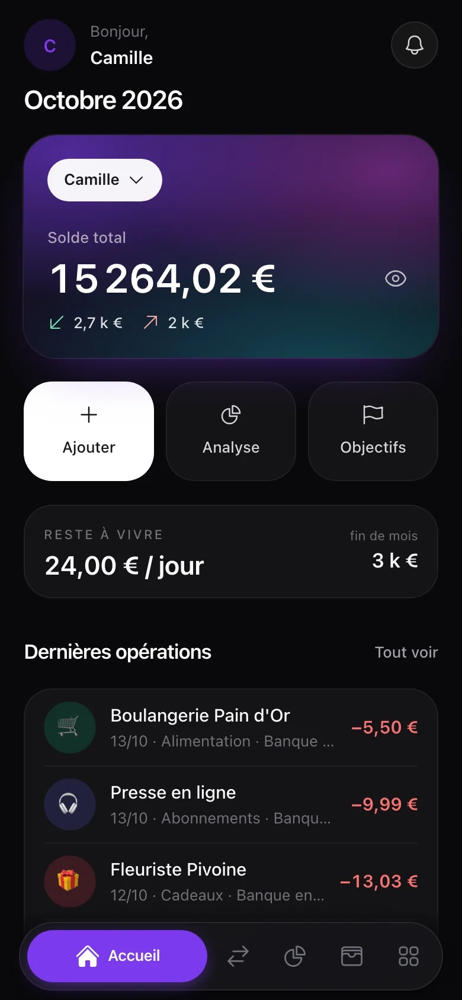
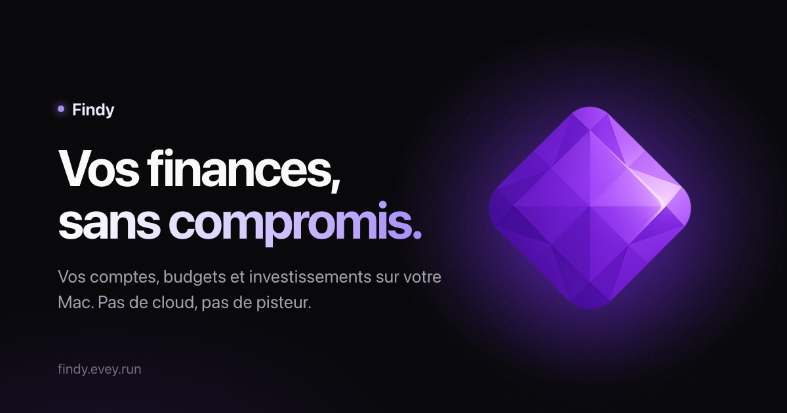

<!-- Généré par tools/build.mjs depuis data/ds.js (findy.gallery) : modifier là-bas, puis relancer le build. -->

# Findy : références

Les visuels « golden » : ce à quoi un rendu doit ressembler. Visuels déjà publiés, copiés depuis les repos findy et findy-site (les captures WebP du site converties en JPEG).

Avant de livrer, mets ta capture à côté de la référence la plus proche et compare la lumière, les marges, la taille et la place du texte. Les règles sont dans [DESIGN.md](../DESIGN.md).

## Tableau de bord Mac

`capture · 1600×1000` : L'app de bureau en mode démo, la capture du héros du site.

**Ce qui marche :** Tout le système en une image : fond presque noir, cartes de verre à peine plus claires (#1C1C1E) cernées d'un filet blanc, violet réservé aux repères (segment Mois, libellés de panneau, entrée active), vert et rouge seulement sur les flux et les montants. Le tableau de bord tient dans la fenêtre sans défiler. Attention : les libellés gris des indicateurs (zinc-500) sont à 3,52:1.

## Accueil Android

`capture · 780×1688` : L'app mobile en mode démo (branche non fusionnée), l'écran du téléphone sur le site.

**Ce qui marche :** Un seul montant lisible à bout de bras, en 34 px sur la carte de solde en maillage violet ; trois actions dont la principale en blanc ; le reste à vivre en deux chiffres ; puis la liste. La barre d'onglets flottante ouvre l'onglet actif en violet avec son libellé, les autres restent des icônes. Seules les dépenses sont en couleur.

## Aperçu de lien

`og · 1200×630` : La carte de partage du site, rendue depuis tools/og.html.

**Ce qui marche :** La gemme violette et son halo à droite, le titre sur deux lignes à gauche dont la seconde en dégradé blanc vers lilas, une phrase en gris et l'adresse en bas : lisible réduite à 400 px, une seule lumière, aucun autre accent.
