<!-- Généré par tools/build.mjs depuis data/ds.js (orivo.gallery) : modifier là-bas, puis relancer le build. -->

# Orivo : références

Les visuels « golden » : ce à quoi un rendu doit ressembler. Campagne exemple rendue par le skill orivo-comms (~/.claude/skills/orivo-comms), à partir de vraies captures de l'app. Commandes à lancer depuis le dossier scripts/ du skill.

Avant de livrer, mets ta capture à côté de la référence la plus proche et compare la lumière, les marges, la taille et la place du texte. Les règles sont dans [DESIGN.md](../DESIGN.md).

## Vue d'ensemble

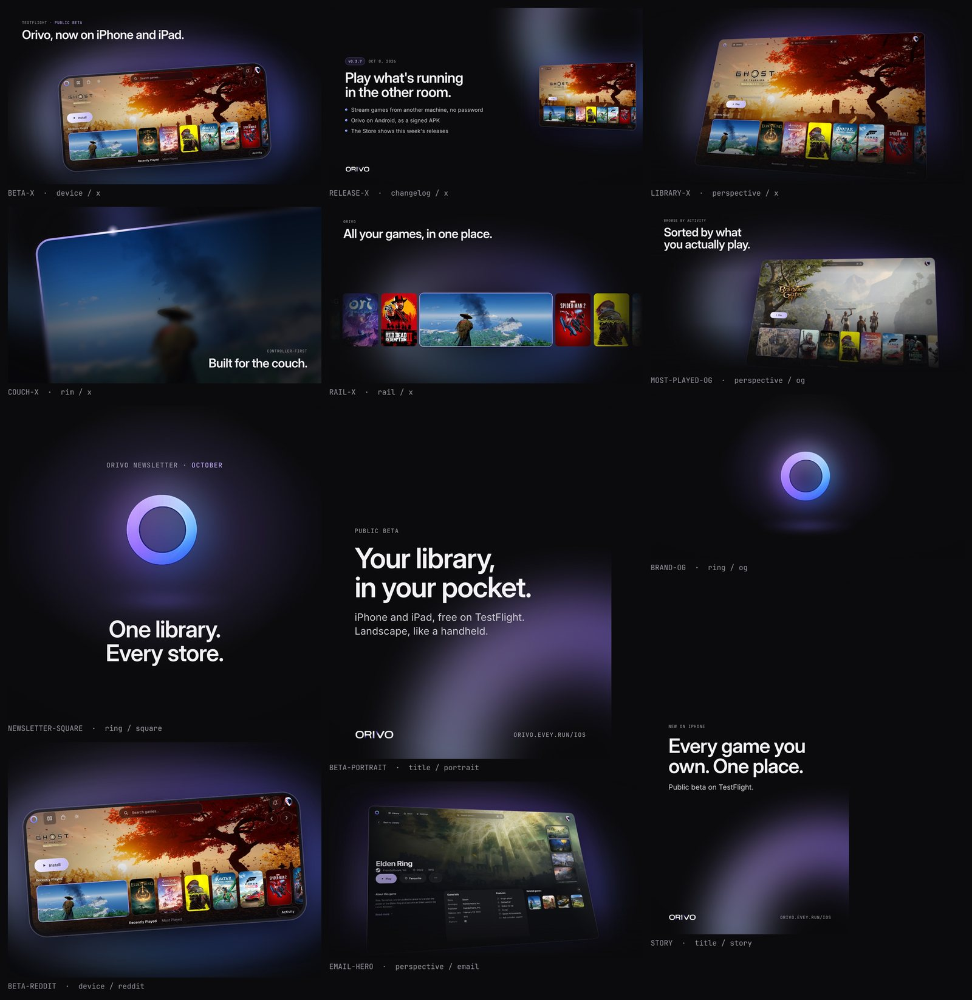

`12 visuels, 7 gabarits` : Une même lumière, un même vide, une même typo sur tous les formats.

**Ce qui marche :** C'est le test de cohérence d'une campagne : la lumière violette reste à la même place relative, le titre garde la même taille et le même interlettrage, le vide domine partout. Attention, la vignette du rail porte encore « All your games, in one place. » avec une virgule ; le slogan s'écrit sans (voir « Le rail »).

```bash
node render.mjs ../examples/campaign.json --out ../examples
```

## Bêta iPhone & iPad

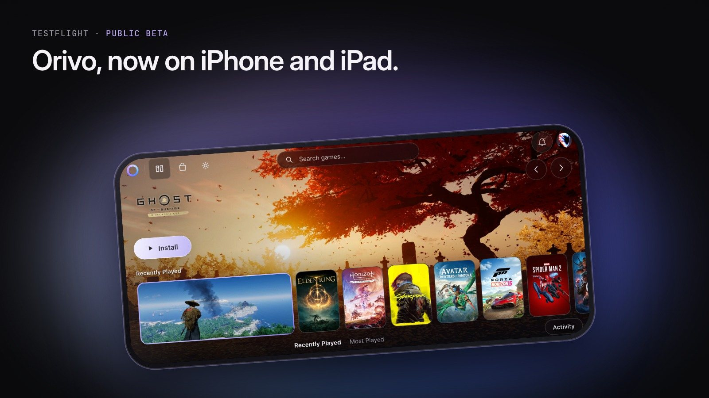

`x · 1600×900` : device — X, Bluesky, Threads, Mastodon.

**Ce qui marche :** Le téléphone en paysage dans un cadre neutre, éclairé par l'anneau depuis le bas ; kicker et titre de cinq mots en haut à gauche, le produit au centre. On voit l'app avant de lire quoi que ce soit.

```bash
node render.mjs --template device --format x --name beta-x --data '{"kicker":"TestFlight · <b>Public beta</b>","title":"Orivo, now on iPhone and iPad."}'
```

## Bêta, post image Reddit

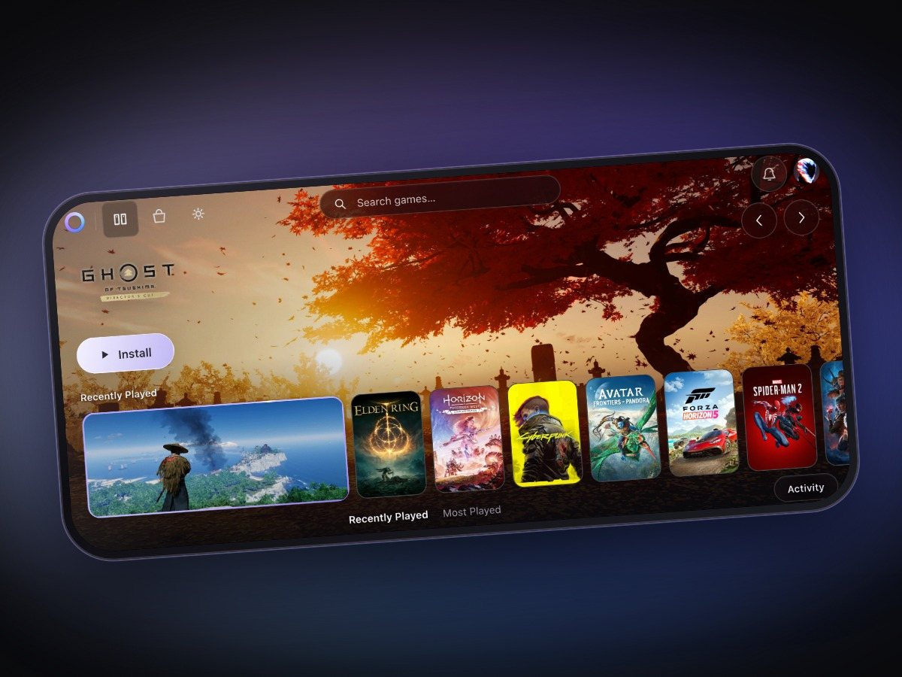

`reddit · 1200×900` : device sans texte : le titre du post porte le message.

**Ce qui marche :** Aucun mot sur l'image : sur Reddit, le titre du post dit la nouvelle et l'image montre seulement l'app. Le 4:3 s'affiche sans recadrage dans le fil.

```bash
node render.mjs --template device --format reddit --name beta-reddit
```

## Version 0.3.7

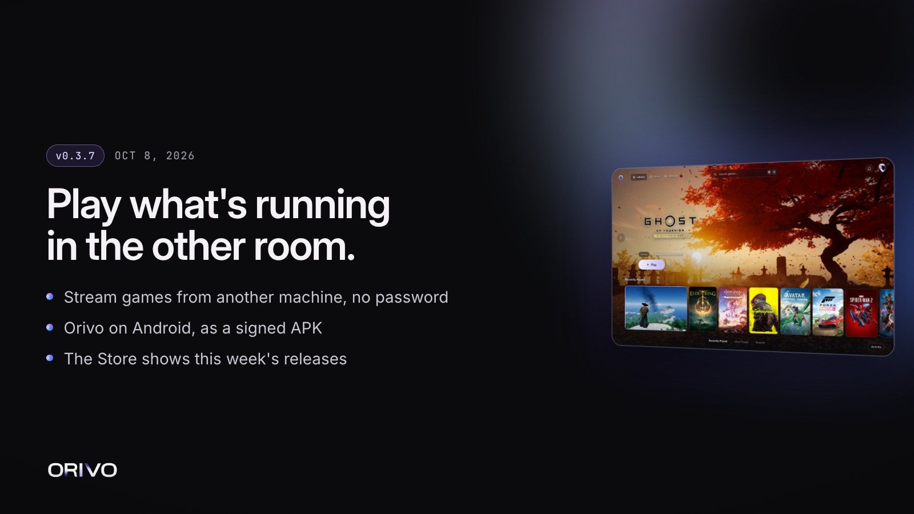

`x · 1600×900` : changelog — post de version (vrais apports de la 0.3.7).

**Ce qui marche :** Pilule de version et date en mono, titre sur deux lignes, trois apports réels en une ligne chacun, petite capture inclinée à droite : la nouvelle se lit en une seconde dans un fil.

```bash
node render.mjs ../examples/campaign.json
```

## La bibliothèque

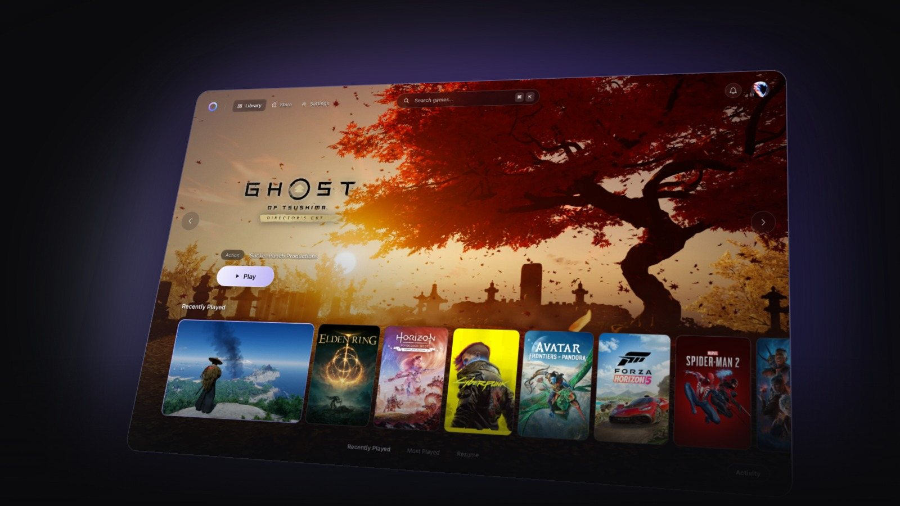

`x · 1600×900` : perspective sans texte — héros de lancement.

**Ce qui marche :** Une vraie capture inclinée sous la lumière, sans un mot : l'app est le message. Le bord droit déborde du cadre exprès, le contenu clé reste dedans.

```bash
node render.mjs --template perspective --format x --name library-x --data '{"image":"mac-library"}'
```

## Pensé pour le canapé

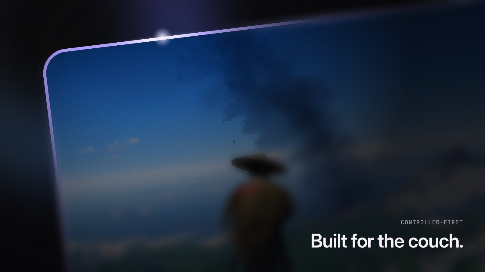

`x · 1600×900` : rim — macro du liseré et de son reflet.

**Ce qui marche :** Le liseré lavande et son reflet en gros plan, le reste dans le flou : la sensation du canapé sans montrer de manette. Le texte passe en bas à droite, comme le veut un macro.

```bash
node render.mjs --template rim --format x --name couch-x --data '{"kicker":"Controller-first","title":"Built for the couch."}'
```

## Le rail

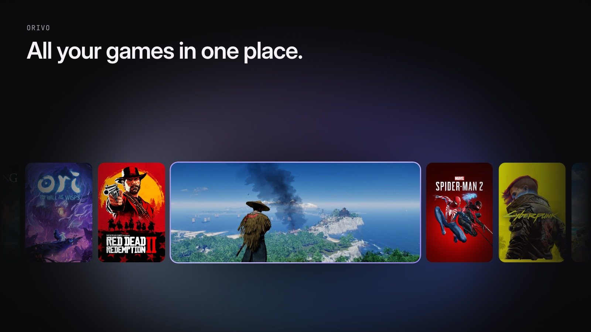

`x · 1600×900` : rail — la promesse d'Orivo en une image.

**Ce qui marche :** Une carte sélectionnée, cerclée du liseré, parmi les jaquettes, exactement comme dans l'app : la promesse d'Orivo sans explication. Le slogan est écrit sans virgule.

```bash
node render.mjs --template rail --format x --name rail-x --data '{"kicker":"Orivo","title":"All your games in one place."}'
```

## Aperçu de lien

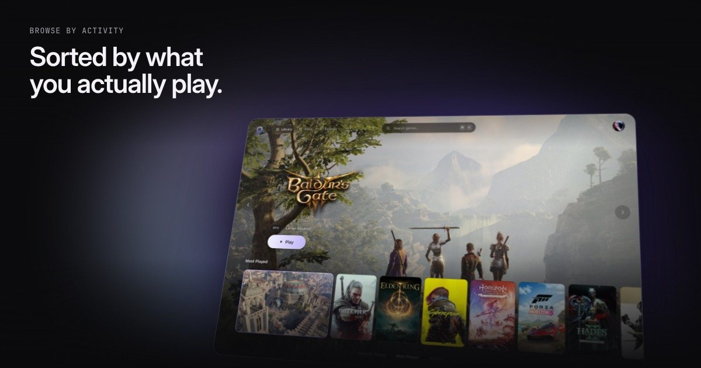

`og · 1200×630` : perspective avec titre — carte de partage.

**Ce qui marche :** Le titre tient en cinq mots à gauche, la capture inclinée à droite : la carte reste lisible réduite à 400 px de large, la taille d'un aperçu dans un fil.

```bash
node render.mjs --template perspective --format og --name most-played-og --data '{"image":"mac-most-played","kicker":"Browse by activity","title":"Sorted by what you actually play."}'
```

## Carte de marque

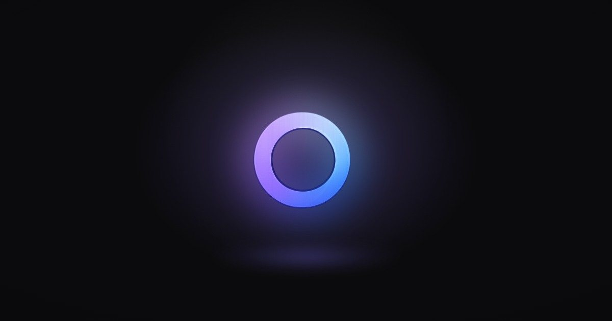

`og · 1200×630` : ring seul — aperçu du site.

**Ce qui marche :** L'anneau seul dans le noir, la lumière qui coule dessous : l'aperçu du site quand il n'y a rien d'autre à dire. Le logo n'est ni recoloré ni déformé.

```bash
node render.mjs --template ring --format og --name brand-og
```

## Newsletter

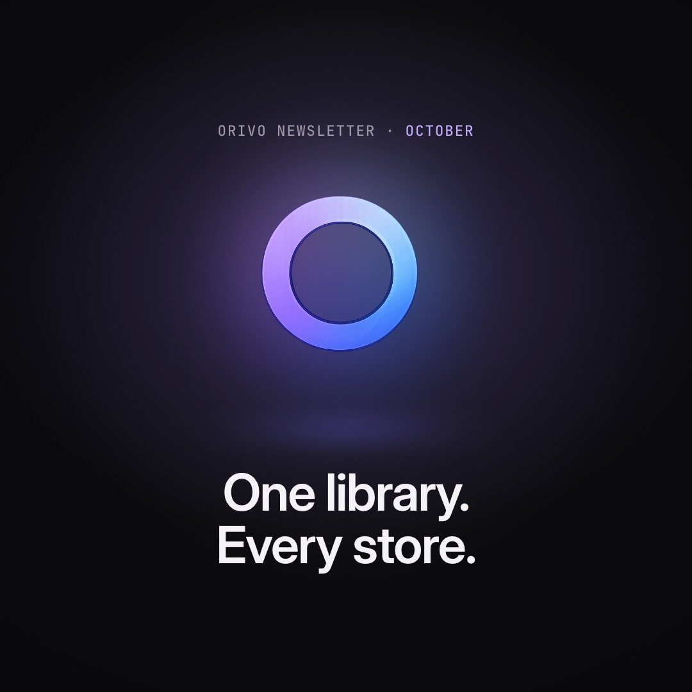

`square · 1080×1080` : ring avec kicker et titre.

**Ce qui marche :** Le kicker accentue un seul mot en Lavender, l'anneau occupe le centre, le titre de quatre mots se place dessous : l'en-tête de newsletter tient en trois éléments.

```bash
node render.mjs --template ring --format square --name newsletter-square --data '{"kicker":"Orivo newsletter · <b>October</b>","title":"One library.\nEvery store."}'
```

## Carrousel Instagram (4 slides)

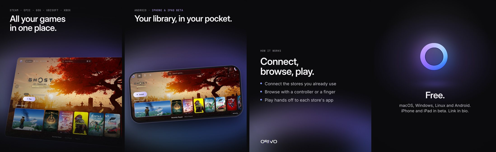

`portrait · 4 × 1080×1350` : perspective → device → title (lumière en bas) → ring : même lumière, même typo.

**Ce qui marche :** La lumière garde la même place d'une slide à l'autre (les slides title prennent light: "bottom"), la première accroche avec le produit, la dernière, l'anneau, porte l'appel à l'action.

```bash
node render.mjs ../examples/campaign.json --out ../examples
```

## Carrousel, slide 1

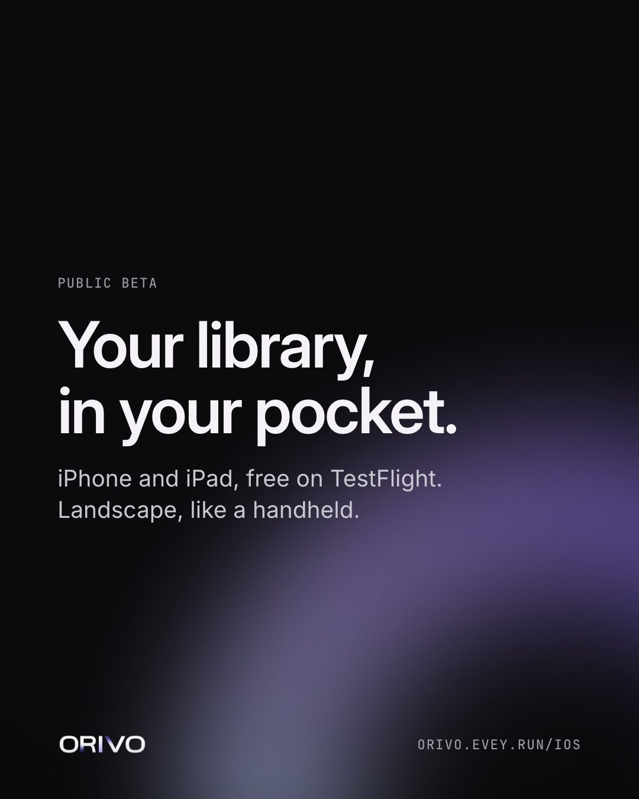

`portrait · 1080×1350` : title — Instagram / Threads.

**Ce qui marche :** Carte de texte : kicker, titre de six mots sur deux lignes, sous-titre en Body, wordmark et URL en bas ; la lumière sort du coin et ne passe jamais derrière le texte.

```bash
node render.mjs --template title --format portrait --name beta-portrait --data '{"kicker":"Public beta","title":"Your library,\nin your pocket.","sub":"iPhone and iPad, free on TestFlight."}'
```

## Story

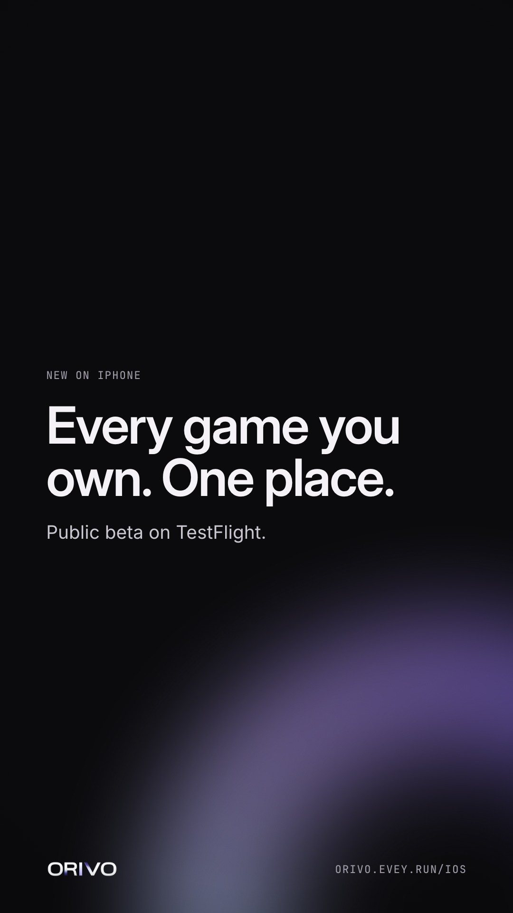

`story · 1080×1920` : title — zones sûres respectées.

**Ce qui marche :** Le texte reste dans les zones sûres, à 250 px du haut et 340 px du bas : l'interface d'Instagram ne cache ni le titre ni le wordmark.

```bash
node render.mjs --template title --format story --name story --data '{"kicker":"New on iPhone","title":"Every game you own. One place."}'
```

## Héros de mail

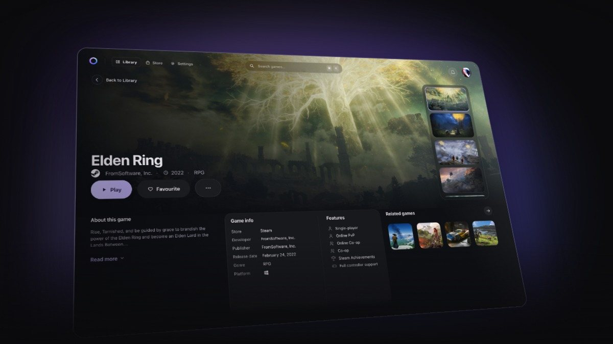

`email · 1200×675` : perspective — en-tête des templates Resend.

**Ce qui marche :** Capture inclinée vers la droite et aucun texte : le mail porte déjà le titre juste en dessous. L'image se lit à 600 px de large, la taille d'affichage d'un mail.

```bash
node render.mjs --template perspective --format email --name email-hero --data '{"image":"mac-game","tilt":"right"}'
```
