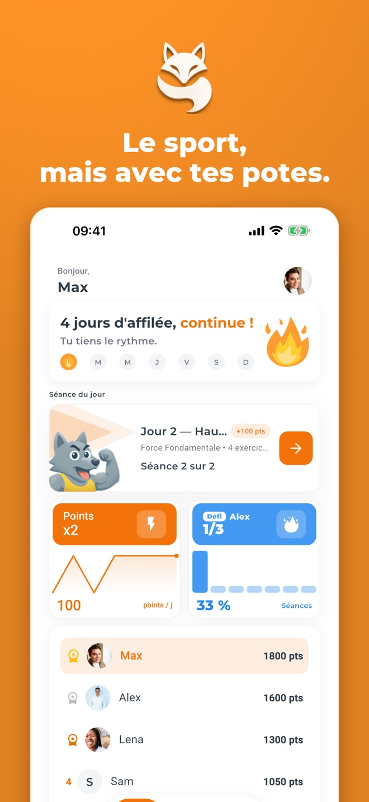
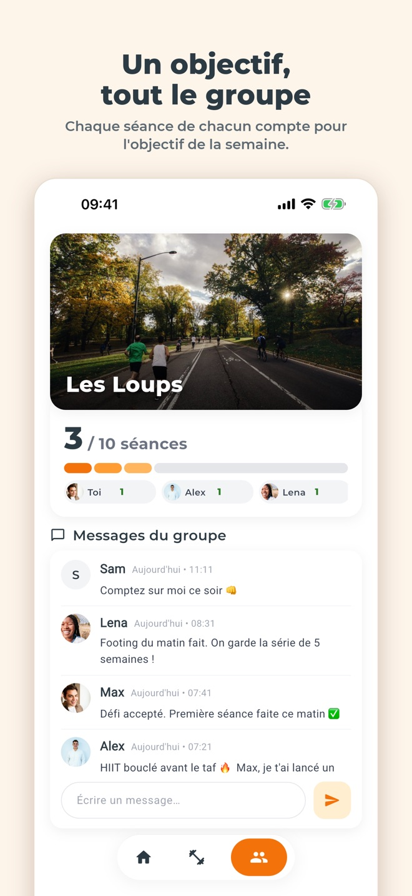
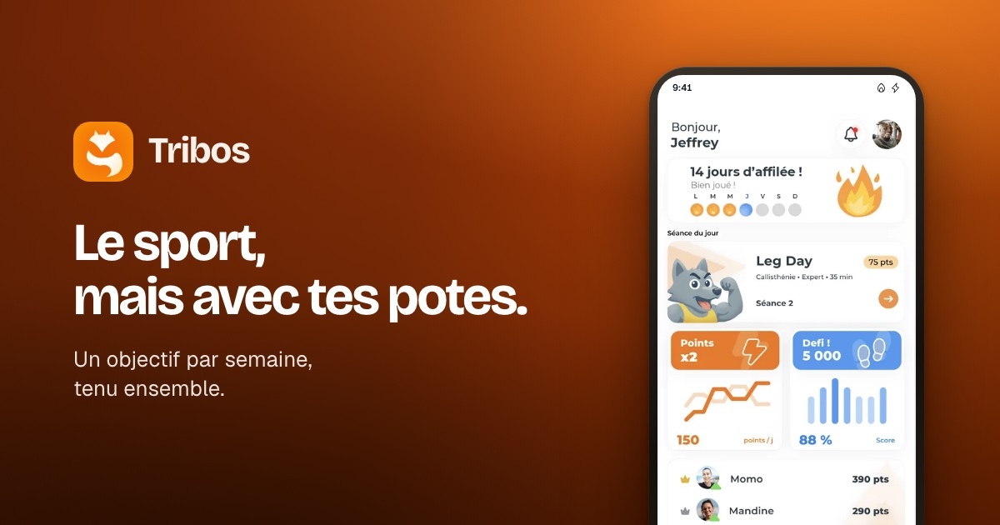

<!-- Généré par tools/build.mjs depuis data/ds.js (tribos.gallery) : modifier là-bas, puis relancer le build. -->

# Tribos : références

Les visuels « golden » : ce à quoi un rendu doit ressembler. Visuels déjà publiés, copiés depuis les repos Tribos et Tribos-Landing-Page.

Avant de livrer, mets ta capture à côté de la référence la plus proche et compare la lumière, les marges, la taille et la place du texte. Les règles sont dans [DESIGN.md](../DESIGN.md).

## Fiche App Store, accueil

`App Store · 1320×2868 (copie à 660 de large)` : couverture en dégradé orange, renard et titre Montserrat ExtraBold, vraie capture de l'accueil.

**Ce qui marche :** La vraie app en français sur le dégradé de marque : série, séance du jour, paire Points ×2 et Défi, classement, barre d'onglets en pilule. L'orange ne sert qu'à ce qui agit ou progresse, tout le reste est blanc. Attention : le titre est blanc sur l'orange (2,89:1) et la carte de la séance montre encore l'ancien loup, hors charte.

## Fiche App Store, groupe

`App Store · 1320×2868 (copie à 660 de large)` : planche crème, titre en encre, écran du groupe qui déborde par le bas.

**Ce qui marche :** Le langage clair sans faute de contraste : fond crème, titre en encre #2C3A43 en Montserrat ExtraBold, barre de l'objectif collectif dans la gamme des oranges, puces de contribution, chat, onglet actif en pilule orange. Le chiffre réalisé porte l'accent, la cible reste en retrait.

## Carte sociale du site

`og · 1200×630` : affiche blaze, titre Bricolage Grotesque, écran d'accueil recréé en DOM.

**Ce qui marche :** La version sombre de la marque : dégradé orange vers brun, titre blanc posé sur la partie sombre de l'affiche, et la vraie app, claire, qui s'en détache. Rendue depuis tools/og-card.html avec les vrais tokens du site, elle reste lisible réduite à 400 px. L'écran porte encore l'ancien loup.
